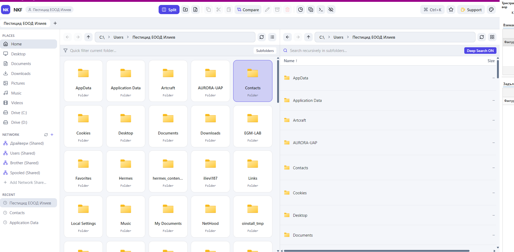

# NKF — NightKnight Files

**NKF (NightKnight Files)** is a fast, modern, Dolphin-inspired dual-pane FOSS File Manager built with **Rust + Tauri v2 + React**. Runs natively on **Linux** and **Windows**.

## Features
- **Dolphin-Style Split View (`F3`) & Tabs (`Ctrl+T`)**: Work across two folders side by side with 1-click copy/move between panes.
- **Quick Look (`Space`)**: Instant inline preview of images, code, Markdown, JSON, logs, and folders without leaving the file manager.
- **Blazing-Fast Rust Search & Quick Filter (`/`)**: Filter current folder instantly or search recursively across subfolders.
- **Smart Batch Rename**: Rename dozens of files at once (find/replace, prefix, suffix, sequential numbering) with live preview.
- **Disk Space Analyzer**: Instantly see which folders and files eat your disk space with visual size bars.
- **Built-in ZIP Archiver**: Compress selected items to `.zip` or extract `.zip` archives in 1 click.
- **OS Trash Support & Open Terminal Here (`F4`)**: Safe delete to Trash (`Del`), permanent delete (`Shift+Del`), and open your terminal directly in the current directory.
- **Rich Themes + Live Omarchy Sync**: NightKnight Obsidian, Paper Light, Tokyo Night, Catppuccin Mocha, Nord Frost, Gruvbox Warm, and live Omarchy Linux theme sync.

## Support
NKF is 100% free & open-source (MIT). If it makes your daily workflow faster:

☕ **[Buy Me a Coffee](https://buymeacoffee.com/aurorauap)**
